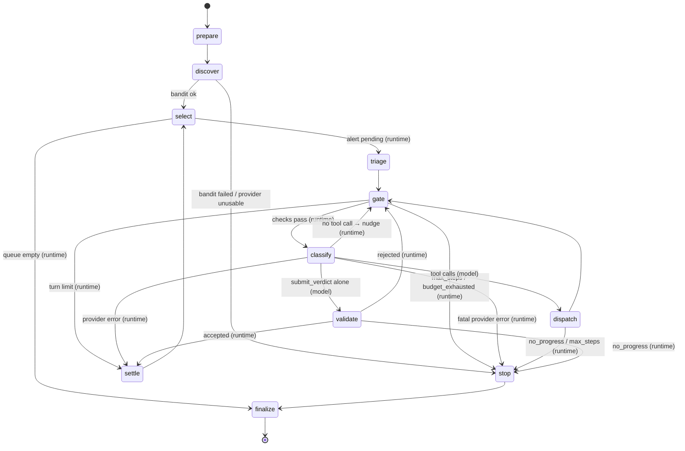
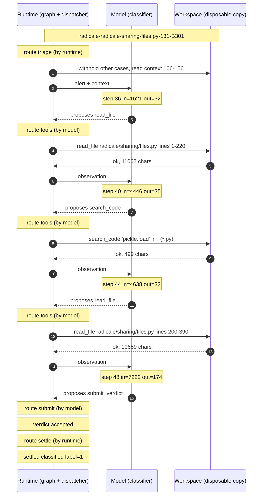

# HW1 design report: a bounded agent for Bandit alert classification

Implementation: `src/hw1_agent/`. Run instructions: [README.md](README.md). Section numbers follow the rubric.

---

## A1. Behaviours

**For each alert the agent:**
1. Hides every other OWASP `BenchmarkTest*` case (A7) and builds a context message: the Bandit fields
   (test id, CWE, severity, confidence, issue text) plus ±25 numbered lines around the flagged line,
   read from the disposable copy.
2. Asks the model to trace the value that reaches the sink back to its source. Is it attacker-influenced
   or constant, trusted or sanitised, and on which paths? The model proposes `read_file`, `search_code` or
   `list_dir` calls, and the runtime executes them.
3. Accepts a `submit_verdict` only after the runtime validates it. The label must be 0 or 1, the rationale
   must cite at least one line, and every evidence range must lie in a file the model may read and inside
   lines the runtime actually showed the model for this alert.
4. Settles the alert's report row exactly once (`classified`, `error` or `budget_exhausted`) and moves
   on to the next alert.

**The agent must never:**
- **Run target code.** Nothing from the target is imported, installed or executed. Bandit is a static
  analyser, invoked as `python -m bandit` with an argument list (no shell). The tools only read bytes.
- **Write to the target.** All tool access goes to a disposable copy. Bandit writes its JSON to a temp
  directory outside the target. There are no write tools.
- **Invent observations.** Only the dispatcher writes observations (tool messages). The model's text is
  never treated as an observation. Evidence must be a subset of lines the runtime displayed, so a
  verdict that cites code the model never saw is rejected.
- **Read withheld material**: `.git/`, `expectedresults*.csv`, or another OWASP case (A7).
- **Invent usage.** The budget charges only provider-reported counters. A call that fails before usage
  is returned records no usage and no `model_call` event.

## A2. State machine

Any uncaught exception, at any node, goes to the crash handler (`Agent._crash`). It settles every
unsettled alert as `error`, writes `report.json`, and writes the single `terminal` event
(`fatal_error`).

## A3. Nodes and edges

| Node | Does | Outgoing edge(s) | Kind | Decided by |
|---|---|---|---|---|
| `prepare` | resolve commit, open the workspace, build the provider | → `discover` | fixed | — |
| `discover` | Bandit `tool_request`/`tool_result`, normalise, sort, assign ids | → `select` / `stop` | conditional | runtime |
| `select` | pick the next unsettled alert | → `triage` / `finalize` | conditional | runtime (`routing triage` / `finalize`) |
| `triage` | per-case withholding, context message, `state_change` | → `gate` | fixed | — |
| `gate` | turn limit, then `max_steps`, then token budget | → `classify` / `settle` / `stop` | conditional | runtime (`routing turn_limit` / `max_steps` / `budget_exhausted`) |
| `classify` | one model call, `model_call` event with reported usage | → `dispatch` / `validate` | conditional | **model** (`routing tools` / `submit`) |
| | | → `gate` (nudge) / `settle` (error) / `stop` (fatal) | conditional | runtime (`no_tool_call` / `error` / `fatal_error`) |
| `dispatch` | run each requested tool through the dispatcher | → `gate` | fixed (default) | — |
| | | → `stop` | conditional | runtime (`no_progress` / `max_steps`) |
| `validate` | check the verdict | → `settle` / `gate` / `stop` | conditional | runtime (`settle` / `reject_verdict` / `no_progress`) |
| `settle` | write the row, one `state_change` with `alert_status` + `label`, restore withheld case files | → `select` | fixed | — |
| `stop` | settle every remaining alert (`budget_exhausted`, or `error` for the other stops) | → `finalize` | fixed | — |
| `finalize` | write `report.json`, then the one `terminal` event | end | fixed | — |

Every conditional edge taken writes exactly one `routing` event with `by`. Fixed and default edges are not traced.
The model chooses only between investigating (`tools`) and finishing (`submit`). Every other
transition is the runtime's.

## A4. Agent state

| Field | Reducer | Lifetime | Writer | Model sees? |
|---|---|---|---|---|
| `alerts` (report rows: status, label, rationale, evidence) | set once per alert in `_settle` (a second write raises) | run | runtime (`settle`, `stop`, crash handler) | no |
| `queue` (unsettled alerts) | remove on settle | run | runtime | no |
| `usage` (`input`, `output`) | add, from provider-reported counters | run | runtime (`classify`) | no |
| trace `usage` mirror (incl. `cache_read`) | add, from written `model_call` events only | run | `Trace.event` | no |
| `steps_used` | add 1 per model call and per tool execution | run | runtime (`classify`, `dispatch`) | no |
| `no_progress_streak` | reset to 0 on progress or settlement, else +1 per turn | run | runtime | no |
| `provider_failures` | +1 per failed call, reset on success | run | runtime | no |
| `first_call_input` | set once (first reported first-turn input) | run | runtime | no |
| `stop` (status, reason) | set once | run | runtime | no |
| `session.messages` | append | alert | runtime (system/context/nudges/tool results) + model (its own assistant turns) | **yes** |
| `session.observed` (path → line numbers shown) | union | alert | dispatcher / triage | no |
| `session.seen_requests` (tool+args fingerprints) | union | alert | dispatcher | no |
| `session.turns` | add | alert | runtime | no (except the final-turn instruction) |
| `session.last_input`, `last_bytes` | overwrite | alert | runtime | no |
| `session.pending_reply` | overwrite | one turn | runtime (`classify`) | it is the model's own reply |
| workspace `active_case`, stash | set per alert, restored at settle | alert | workspace | no |

The model never writes state directly. Its only outputs are proposals, tool calls and verdicts, and
the runtime validates each one before anything changes.

## A5. Tools

All tools take repo-relative POSIX paths and go through `Workspace.resolve` (A7) before touching
disk. A refusal comes back as an observation beginning `REFUSED:` with a `tool_result ok=false error=…`
event. It never raises. The dispatcher refuses an unknown tool name, arguments that are not a JSON
object, arguments that fail the tool's JSON Schema (wrong type, missing or extra keys), and an exact
repeat of an earlier request for the same alert. Results are capped at 12,000 characters. On
truncation, only the lines still visible count as observed.

| Tool | Arguments | Returns | Limits | Refusals |
|---|---|---|---|---|
| `read_file` | `path`, `start_line ≥ 1`, `end_line ≥ start_line` | numbered lines + `[file has N lines; showing a-b]` | ≤ 200 lines per call; lines > 400 chars truncated | path refused (absolute, `..`, outside the copy, withheld); not a file; binary; `start_line` past EOF; `end_line < start_line` |
| `search_code` | `pattern` (literal, 1–200 chars), `path` (default `.`), `glob` (file-name pattern, default `*.py`), `case_sensitive` | `path:line: text` hits | ≤ 50 hits; files > 2 MB skipped; ≤ 30,000 files scanned; literal match only (no regex, so no ReDoS) | bad pattern/glob; path refused or missing. Withheld files are silently skipped. |
| `list_dir` | `path` | sorted entries, dirs end in `/` | ≤ 200 entries | path refused; not a directory. Withheld entries are not listed. |
| `submit_verdict` (finish) | `label ∈ {0,1}`, `rationale`, `evidence[1..5]` of `{path,start_line,end_line}` | — (ends the alert) | ranges ≤ 200 lines; rationale stored up to 3,000 chars | rejected if: called together with other tools; schema fails; rationale empty or cites no line; evidence path refused or not a file; any cited line was never shown to the model |

Bandit is the runtime's discovery tool, traced as `tool_request`/`tool_result` with `tool: "bandit"`.
The model cannot call it.

## A6. Start, stop and termination

**Start.** The CLI parses `--input/--output/--config`. The config must parse as TOML and validate
against `config.schema.json`. If it does not, the run never starts and the trace ends `config_invalid`.
`[agent]` keys (`max_turns_per_alert`, `no_progress_limit`, `request_timeout_s`) are optional.

**Terminal statuses.** Closed and mutually exclusive. Exactly one is written, as the last event.

| Status | Trigger | Rows still unsettled become |
|---|---|---|
| `completed` | every alert settled by the agent loop | — |
| `budget_exhausted` | budget gate: `required > max_tokens − used` before a model call | `budget_exhausted`, `label: null` |
| `max_steps` | `steps_used + 1 > max_steps` before a model call or a tool execution | `error` ("run stopped (max_steps)") |
| `no_progress` | `no_progress_limit` consecutive model turns with no new observation: no tool call, all requests refused or duplicated, or verdict rejected | `error` |
| `fatal_error` | uncaught exception, Bandit failure, unusable provider (missing key, auth, unknown model, invalid parameter, quota), or 3 consecutive failed calls | `error` |
| `config_invalid` | config rejected before any scan or model call | (no rows) |

**Precedence** is fixed by where each check runs. A crash pre-empts everything. In `gate`, `max_steps`
is checked before the budget. `no_progress` is evaluated after a turn's observations. The first
check to fire stops the run, so two statuses can never both apply.

**Budget policy.**
- *Charge*: `used = Σ (input + output)` over `model_call` events, as reported by the provider. For OpenAI,
  `input = prompt_tokens` and `output = completion_tokens`, which includes reasoning tokens.
  `cache_read = prompt_tokens_details.cached_tokens` is recorded and never charged. OpenAI reports no
  cache-write counter. `report.budget.used_tokens` is computed from the trace's own mirror of the
  `model_call` events, so it equals the trace sum by construction.
- *Output allowance*: `budget.output_allowance` is sent as `max_completion_tokens` on every call.
- *When it is checked*: in `gate`, before every model call. Required =
  `projected_input + output_allowance`, and the call is made only if `required ≤ max_tokens − used`.
- *Projection* (gate only, never charged): an upper bound built from provider numbers. A BPE token
  covers at least one byte, so the UTF-8 bytes added since the previous call bound the tokens added:
  `projected = last reported input + bytes added + 16/message`. A new alert's first call uses the
  first reported first-turn input plus the new alert message's bytes. Before any report exists, it uses
  the whole request's bytes. Because the projection is an upper bound and output is capped by the
  allowance, `used ≤ max_tokens` always holds.
- *At the cutoff*: a `routing` event `budget_exhausted` by `runtime` records `remaining` and `required`.
  The current and all later alerts get `budget_exhausted` rows (one `state_change` each). Then
  `report.json` is written with `exhausted: true`, followed by `terminal budget_exhausted`.

**Per-alert bound.** At most `max_turns_per_alert` model calls per alert. On the last one the runtime
forces `tool_choice = submit_verdict`. If that verdict is still rejected, the alert settles `error` and
the run continues.

## A7. Workspace and withholding

| Withheld | Targets | Why | How | Restored |
|---|---|---|---|---|
| `.git/` | all | history may contain commits after the pin, including fixes | never copied (`copytree(ignore=.git)`); `resolve` refuses any `.git` component | nothing moved; the original is untouched |
| `expectedresults*.csv` | OWASP (rule applies everywhere) | the answer key | moved from the copy into a sibling stash (`repo-withheld/`) for the whole run; `resolve` refuses the name | moved back on workspace exit, then the copy is deleted |
| every `BenchmarkTest*` file except the current case's files (`.py` and its `templates/web/*/BenchmarkTest<id>.html`) | OWASP | each case has a safe twin, so the answer is one grep away | moved to the stash in `triage` for that alert; `resolve` refuses non-active case names | moved back in `settle`, and on exit |

**One path check.** `Workspace.resolve(path)` is the only route from a tool argument to the file system.
It refuses non-strings, NUL bytes, absolute paths (including drive letters), any `..` component,
withheld names, and anything whose fully resolved path, with symlinks followed, lies outside the
copy, or whose resolved target is withheld. `search_code` and `list_dir` call `resolve` on every file
or entry they would return, so withheld files are invisible to them too, not only to direct reads.
Discovery (Bandit) scans the original `--input` in full, as required, and never writes to it.
`helpers/` is not withheld.

---

## C2. Results

Model: `gpt-5.4-mini` (`reasoning_effort = "none"`). Each run's config is the corresponding file in `configs/targets/`.

| run | alerts | label 1 | label 0 | null | used / max tokens | terminal |
|---|---|---|---|---|---|---|
| radicale-full | 10 | 6 | 4 | 0 | 161304 / 1500000 | completed |
| radicale-low | 10 | 0 | 3 | 7 | 37278 / 50000 | budget_exhausted |
| sglang-full | 21 | 13 | 8 | 0 | 215298 / 1500000 | completed |
| sglang-low | 21 | 3 | 0 | 18 | 40941 / 50000 | budget_exhausted |
| owasp-full | 18 | 10 | 8 | 0 | 47336 / 1500000 | completed |
| owasp-low | 18 | 6 | 9 | 3 | 44075 / 50000 | budget_exhausted |

**OWASP precision / recall (full run):** TP=6, FP=4, FN=2, TN=6 → precision 0.600, recall 0.750.

**How the labels were used to refine the agent.** On the full OWASP run the agent labelled 12 of the
18 alerts correctly. We compared each wrong label with its rationale and trace, and the errors fall
into three groups:

- *A guard was seen but not trusted* (false positives: `00073` B307, `00075` B102). Both rationales
  cite the check on lines 46-50 that only lets a quoted string literal through, yet still treat
  `eval`/`exec` as reachable from the cookie. The model took "the value comes from a cookie" as
  enough, even though the label definition says a value neutralised on every path is a 0.
- *Parser defaults were assumed unsafe* (false positives: `00017` B317 and B318). The model reasoned
  that a cookie-controlled document reaching `xml.sax` and `minidom` "without defusing" means XXE,
  without checking whether those parsers resolve external entities by default.
- *Weak hashes were judged by how the digest is used* (false negatives: `00058`, `00060`, B324). The
  model called SHA-1 safe because the digest is only written to a file and gates no security
  decision. In `00060` it also leaned on the test/dev-only exemption because the file sits under
  `testcode/`, which is true of every OWASP case. The benchmark marks both as vulnerable.

These cases shaped the prompt. The label-0 criteria name the safe uses explicitly
(`usedforsecurity=False`, checksum or cache key only), and investigation step 3 tells the model to
check every path, including values overwritten by a constant or selected away by a fixed condition,
instead of stopping at the first tainted assignment. The remaining errors point to the next changes:
asking the model to confirm that a guard can actually be bypassed before labelling 1, to check a
parser's defaults rather than assume them, and to apply the test-only exemption only when the code
really cannot run in production, not because of a directory name. Because Radicale and SGLang are
held out, we kept these as general rules rather than patterns specific to the benchmark.

**Trajectory of one alert** (from `runs/radicale-full/trace.jsonl`):

## C3. Limitations and alternatives

**Limitations of this design.**
- One ReAct-style loop per alert, so alerts run strictly one after another. Latency is the sum of the
  per-alert loops.
- The byte-based budget projection is safe but pessimistic. Near the cutoff it may refuse a call
  that would actually have fit.
- `no_progress` and `max_steps` end the whole run, as the brief requires, even when only one alert is stuck.
  The per-alert turn cap with a forced final submit keeps one stuck alert from triggering them in
  ordinary cases.
- The evidence check proves the model *saw* the cited lines, not that its reasoning about them is right.
- The context is rebuilt from scratch for each alert. Nothing learned about shared helpers carries over.

**Alternatives** (analysed, not built):

| | This agent (ReAct loop per alert) | Fixed workflow | Plan-and-execute | Supervisor / worker |
|---|---|---|---|---|
| Shape | model chooses tools until it submits; runtime gates every step | runtime always does the same steps (context ±N lines → one classify call) | planner writes an investigation plan per alert; executor runs it; optional re-plan | supervisor routes alerts (or sub-questions) to specialised workers (e.g. taint tracer, crypto-usage checker), then aggregates |
| Cost | 2–4 calls per alert typically; grows with the transcript | lowest: 1 call per alert, fixed size | planner call + executor calls; re-planning adds more | highest: supervisor calls + several workers, each with its own context |
| Latency | sequential turns per alert | lowest, and trivially parallel across alerts | plan is serial; plan steps can run in parallel | workers can run in parallel, but the supervisor serialises aggregation |
| Coordination | none: one actor; runtime owns state | none | plan ↔ execution drift; must decide when to re-plan | hardest: hand-offs, shared state, conflicting worker verdicts |
| Failure behaviour | local: bad requests become refusals; loops caught by duplicate refusal, turn cap and no-progress | cannot recover from missing context (e.g. taint source in another file), so it fails silently with a wrong label | a wrong plan wastes the whole budget on irrelevant reads unless validated; re-planning adds loop risk | one failing worker can stall aggregation; errors compound across hand-offs; harder to keep the one-settlement-per-row invariant |
| Fit here | good: alerts need a variable amount of cross-file reading | good for single-file OWASP cases, weak on Radicale/SGLang | useful for big repos (SGLang) where reading should be planned | probably overkill for 10–21 alerts |
